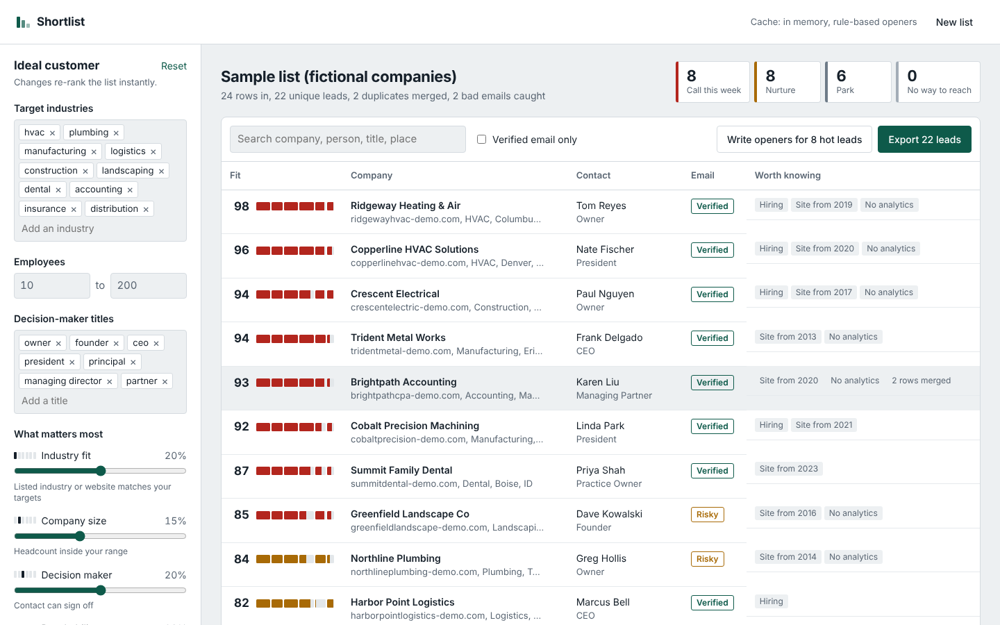
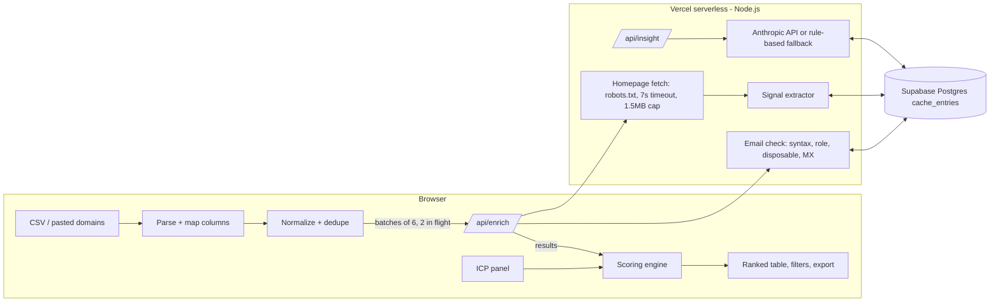

# Shortlist

**Turn a scraped lead list into this week's call list.**

SaaSquatch is good at *finding* companies. The step after that is still manual: a rep opens a CSV with hundreds of rows, half-duplicated, some emails dead, and has to guess who to call first. Shortlist does that triage. Drop in an export and it:

1. **Merges duplicates.** It matches on email, or on the same person at the same domain, and fills blanks from the merged rows.
2. **Checks every email.** It checks syntax, flags disposable providers, shared inboxes (`info@`) and personal Gmail-type addresses, and does a live DNS MX lookup.
3. **Reads each company's homepage** (politely, once a week) for tech stack, how recently the site was updated, hiring signals, socials, phone numbers and contact emails.
4. **Scores each lead 0–100** against an ideal customer profile you can edit, and shows the reason behind each point.
5. **Writes a "why call" note and a first line for outreach,** either with AI or from rules when no AI key is set.
6. **Exports** a full CSV (your original columns are kept) or a CSV that HubSpot's importer maps automatically.



## Why this feature

Caprae buys established, often owner-led businesses and creates value **after** the acquisition, much of it by bringing modern tooling and AI to companies that don't have them. So the leads worth calling first aren't the most polished companies. They're the ones that fit the profile *and* have room to improve.

Shortlist scores that directly. A **modernization gap** signal treats a site last touched in 2016, with no analytics and no CRM, as upside rather than a red flag. Changing the weights turns the same engine into a standard sales-prospecting scorer.

I went **quality first**: one workflow done end to end, instead of several thin tools. The rubric asks for deduplication, validation, enrichment, prioritization and workflow integration, and those are exactly the stages of that one workflow.

## How the score works

Six signals. Each earns 0–1 of its weight, and the weights are normalized so the score always reads out of 100. Every signal carries a plain-English reason, shown in the lead drawer.

| Signal | Default weight | Full points when |
|---|---|---|
| Industry fit | 20 | Listed industry matches a target industry (75% if only the website mentions it) |
| Company size | 15 | Headcount is inside your range (50% if within ±50% of it) |
| Decision maker | 20 | Title matches owner, founder, CEO, president… (55% for VP or director) |
| Reachability | 20 | Verified email + phone + LinkedIn |
| Modernization gap | 15 | Site 3+ years stale, no analytics, no CRM or email marketing, no chat, no HTTPS |
| Business activity | 10 | Live site, hiring, active blog or socials, sells online |

Tiers: **Hot ≥ 85** (call this week), **Warm ≥ 60** (nurture), **Cold** (park), and **No way to reach** (no valid email, no phone and no live site).

The **fit meter** in each row has one cell per signal. Each cell is as wide as its weight and filled by how much of that signal the lead earned, so you can see *why* a lead ranks where it does without opening it. The scoring runs in the browser, so editing the profile re-ranks the whole list instantly with no server round trip.

## Architecture



**Why it's split this way:**
- **Network work runs on the server.** Browsers can't do DNS MX lookups or fetch other sites (CORS), and doing it server-side keeps one polite user agent and one shared cache.
- **Thinking happens in the browser.** Parsing, deduping and scoring are pure TypeScript functions that run client-side, so the UI is instant and the server stays stateless.
- **Small batches.** The client sends 6 leads per request, 2 requests at a time. Each serverless call finishes in seconds, far inside Vercel's limits; the table fills in progressively; and one slow site can't stall the run. Within a batch, leads from the same company share one homepage fetch.

## Tech stack

| Layer | Choice | Why |
|---|---|---|
| Framework | **Next.js 15 (App Router) + React 19 + TypeScript** | One repo and one deploy for UI and API |
| UI | **Plain CSS with design tokens**, Schibsted Grotesk via `next/font` | No UI kit to fight; small bundle; light and dark mode |
| API | **Next.js Route Handlers** on the **Node.js runtime** (`/api/enrich`, `/api/insight`, `/api/health`) | `node:dns` is needed for MX lookups |
| Database | **Supabase Postgres** (`cache_entries` table, JSONB values with a TTL), reached through its REST API | Managed Postgres with a free tier; no SDK needed; row-level security on with no policies, so only the server can access it |
| Cache | Two tiers: an **in-process Map** (survives while a serverless instance is warm) in front of **Postgres** (shared across instances) | Each domain is fetched at most once a week; failures are retried after a day |
| AI | **Anthropic Messages API** (Claude Haiku by default; set with `ANTHROPIC_MODEL`) | Only extracted facts are sent, not raw HTML, so calls are small and cheap |
| Hosting | **Vercel**: static pages on its CDN, API routes as serverless functions; Vercel runs on **AWS** | Zero-config Next.js hosting |
| Deploy | Push to `main` → Vercel builds and deploys; every PR gets a preview URL | |
| Parsing | Hand-written CSV parser and regex extractors | Zero runtime dependencies beyond Next/React; tolerant of broken small-business HTML |

## Performance and reliability

- Two-tier cache: memory → Postgres → network. The first run on a list does the network work; re-runs and re-scores are instant.
- Timeouts everywhere: 7 s per page, 4 s for robots.txt and DNS, 15 s for AI calls. Pages are read in a stream and cut off at 1.5 MB.
- Concurrency: 4 parallel site fetches per request and 2 requests in flight from the browser, which gives roughly 8 sites at a time without hammering anyone.
- A failure degrades instead of breaking: a batch that errors is marked "could not verify" and the run continues, and an AI failure falls back to rules.

## Ethical collection

- Identifies itself (`ShortlistBot/1.0`), **honours robots.txt**, fetches one public page per domain per week, and never logs in, bypasses a CAPTCHA, or rotates IPs to evade blocks.
- No SMTP mailbox probing (it's intrusive and gets IPs blocklisted); MX lookups only.
- An **SSRF guard** refuses domains that resolve to private or loopback addresses, and domains are normalized before any fetch.
- CSV export neutralizes spreadsheet formula injection (`=`, `+`, `-`, `@`).

## Run it locally

```bash
git clone <this repo> && cd shortlist
npm install
cp .env.example .env.local   # optional; everything works without it
npm run dev                  # http://localhost:3000
```

Click **"Try a sample list"** for an offline demo. The sample companies are fictional, so the sample ships with a frozen enrichment snapshot (`public/demo/sample-enrichment.json`, regenerated with `npm run demo:fixture`) produced by the real extractor and email checker. Pasting real domains or uploading a real CSV uses the live pipeline.

```bash
npm test          # unit tests: CSV, dedupe, extraction, robots.txt, scoring
npm run typecheck
```

### Optional: Supabase cache

1. Create a Supabase project and run `supabase/schema.sql` in the SQL editor.
2. Set `SUPABASE_URL` and `SUPABASE_SERVICE_ROLE_KEY`. The header will show "Cache: Supabase".

### Optional: AI openers

Set `ANTHROPIC_API_KEY`. Without it, notes and openers are written by rules from the same facts.

### Deploy to Vercel

Import the repo in Vercel, add the environment variables above, and deploy. No other configuration is needed.

## Project layout

```
app/                 Next.js pages and API route handlers (thin wrappers)
components/          Workbench, import, column mapper, ICP panel, table, drawer, fit meter
lib/                 Pure logic shared by browser and server: CSV, normalize/dedupe, extract, score, exporters
lib/server/          Server-only: enrichment, email check, cache, AI, request handlers
public/demo/         Sample list and its enrichment snapshot
scripts/             Demo fixture generator
supabase/schema.sql  Cache table
tests/               node:test unit tests
```

## Trade-offs and what's next

- **JavaScript-rendered sites** return thin HTML to a plain fetch. Next step: a headless-browser fallback (e.g. a Playwright worker on a small container) used only when the static HTML is nearly empty.
- **Scale:** for lists in the tens of thousands, move enrichment to a queue (Supabase queues, or SQS + Lambda) and stream progress back to the UI, rather than having the browser drive batches.
- **More sources:** Google Business Profile reviews and age, state business registries (years in business is a strong owner-retirement signal), and LinkedIn headcount trends.
- **CRM sync:** push straight to HubSpot or Salesforce through their APIs instead of a CSV, and write the score to a custom property.
- **Learning weights:** once there's outcome data (replied, meeting booked), fit the weights to it instead of setting them by hand.

## How this was built

Built within the challenge's time box, with an AI coding assistant (Claude) for pair-programming. I chose the problem, the scoring model and the architecture, and I reviewed and tested the code.
